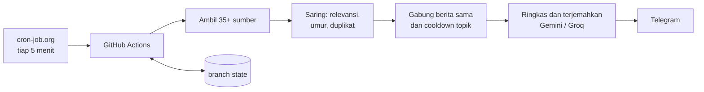

<div align="center">

# 🔴 Man Utd News Bot

**Pemantau berita Manchester United yang berjalan otomatis di GitHub Actions.**
Mengumpulkan puluhan sumber, menyaring berita ganda, meringkasnya ke bahasa Indonesia, lalu mengirimnya ke Telegram.


</div>

---

## Fitur

- **35+ sumber gratis**: RSS media utama dan blog fans, Google News (termasuk pencarian per situs), Guardian API, GDELT, GNews, dan NewsData. Reddit tersedia tetapi nonaktif secara default karena memblokir server GitHub.
- **Anti-ganda**: berita yang sama dari banyak sumber hanya dikirim sekali. Sumber tambahan digabung ke pesan lama dengan mengedit pesan itu.
- **Cooldown topik**: topik yang baru dikirim ditahan selama 15 menit (default). Kabar yang naik tingkat, misalnya rumor menjadi resmi, tetap langsung lewat.
- **Filter tren**: berita dari blog baru dikirim jika didukung sumber lain atau ramai di Reddit.
- **Laporan singkat bergaya jurnalis** berbahasa Indonesia: kalimat pendek dan padat tanpa membuang poin penting (Gemini, dengan Groq sebagai cadangan).
- **Sumber ditulis jurnalisnya**: platform besar tetap ditulis namanya, sedangkan platform kecil atau komunitas diganti nama jurnalis yang dikutip (Romano, Ornstein, Whitwell, dll.).
- **Draf opini berpov Anda**: balas (quote) sebuah berita, kirim `/opini`, dan bot membalas dengan draf opini.
- **Pelabelan otomatis**: `[BREAKING NEWS]`, `[RESMI]`, `[RUMOR]`, `[TRANSFER]`, `[CEDERA]`, `[INTERVIEW]`, `[PUNDIT]`, `[DRAMA]`, `[PERTANDINGAN]`, `[BERITA]`.
- **Kontrol lewat Telegram**: `/status`, `/pause`, `/resume`, `/cooldown`, `/batas`, `/sumber`, `/terakhir`, `/pengingat`, `/opini`. Semua balasan bot mengutip perintah Anda.
- **Pengingat terjadwal**: mis. masa berlaku token GitHub, dikirim beberapa hari sebelum kedaluwarsa.
- **Peringatan kesehatan**: sumber yang mati dilaporkan dalam satu pesan gabungan, dan run yang gagal diberi tahu ke Telegram.
- **Penjaga berita basi dan tidak relevan**: tanggal terbit diverifikasi dari halaman artikel, dan AI diminta menandai berita lama atau yang tidak berkaitan dengan Man Utd sehingga tidak ikut terkirim.

## Contoh pesan

```
[RUMOR]

Manchester United dilaporkan tertarik merekrut ... Menurut laporan tersebut, ...

(BBC Sport, Sky Sports)
```

Label ditampilkan **tebal** dan sumber *miring* di Telegram.

## Cara kerja



Setiap siklus berjalan sekitar satu menit. State (berita yang sudah dilihat, cooldown, pengaturan) disimpan sebagai satu commit di branch `state`, jadi riwayat repo tetap bersih.

## Struktur

```
bot/            kode utama (pipeline, sumber, ringkasan, Telegram)
config/         settings.yaml (aturan) dan sources.yaml (daftar sumber)
scripts/        skrip simpan dan ambil state
tests/          pengujian otomatis
docs/           panduan pemasangan
.github/        workflow GitHub Actions
```

## Konfigurasi

Semua aturan ada di `config/settings.yaml`. Beberapa yang paling sering diubah:

| Pengaturan | Default | Arti |
|---|---|---|
| `cooldown.minutes` | 15 | Jeda untuk topik yang sama |
| `rate.max_per_hour` | 10 | Batas pesan biasa per jam (BREAKING dan RESMI tanpa batas) |
| `trend.hold_minutes` | 45 | Lama menunggu dukungan sumber lain bagi berita blog |
| `max_item_age_hours` | 6 | Berita lebih tua dari ini diabaikan |
| `dedupe.strong_threshold` | 0.5 | Ambang kemiripan berita yang sama |

Daftar sumber ada di `config/sources.yaml`. Tambah atau nonaktifkan sumber cukup dengan mengedit satu baris.

## Pemasangan

Lihat **[docs/PANDUAN.md](docs/PANDUAN.md)**. Singkatnya: buat bot Telegram, ambil kunci API gratis, isi GitHub Secrets, lalu atur cron-job.org sebagai pemicu.

## Rahasia dan keamanan

Token dan kunci API **hanya** disimpan di GitHub Secrets dan tidak pernah ada di kode. Isi artikel publik dikirim ke layanan AI (Gemini atau Groq) hanya untuk diringkas.

## Pengujian

```bash
python -m unittest discover -s tests
```

## Catatan

Bot ini untuk pemantauan pribadi. Ringkasan dikirim ke chat Telegram pribadi, bukan diterbitkan ulang. Hormati ketentuan tiap sumber berita.

## Lisensi

MIT
