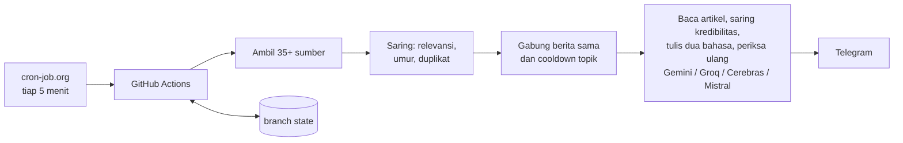

<div align="center">

# 🔴 Man Utd News Bot

**Pemantau berita Manchester United yang berjalan otomatis di GitHub Actions.**
Mengumpulkan puluhan sumber, menyaring berita ganda, meringkasnya ke bahasa Indonesia, lalu mengirimnya ke Telegram.


</div>

---

## Fitur

- **35+ sumber gratis**: RSS media utama dan blog fans, Google News (termasuk pencarian per situs), Guardian API, GDELT, GNews, dan NewsData. Reddit tersedia tetapi nonaktif secara default karena memblokir server GitHub.
- **Anti-ganda**: berita yang sama dari banyak sumber hanya dikirim sekali. Sumber tambahan digabung ke pesan lama dengan mengedit pesan itu.
- **Cooldown topik**: topik yang baru dikirim ditahan selama 15 menit (default). Kabar yang naik tingkat, misalnya rumor menjadi resmi, tetap langsung lewat.
- **Filter tren**: berita dari blog baru dikirim jika didukung sumber lain atau ramai di Reddit.
- **Headline dan isi singkat** dalam dua bahasa (Indonesia dan Inggris): satu kalimat headline yang ditulis ulang dengan bahasa sendiri dan berdiri sendiri (siap diposting terpisah), lalu isi maksimal 300 karakter yang memuat poin pentingnya, dengan tautan sumber.
- **Kutipan wawancara persis**: berita `[INTERVIEW]` dan `[PUNDIT]` memuat konteks lalu kutipan dalam format `Nama: “kutipan”. “kutipan”, told @Media.` Kutipan Inggris diperiksa kode agar benar-benar ada di artikel (tidak mungkin karangan AI); versi Indonesia berisi terjemahannya.
- **Membaca artikel penuh dan menyaring kredibilitas**: bot mengambil teks utama artikel (iklan dan berita terkait dibuang), menentukan jenis tulisan, tingkat kepastian, dan sumber klaim. Media golongan A/B dikirim langsung. Sumber lain (Football365, CaughtOffside, GiveMeSport, Mail, Mirror, blog) hanya dikirim bila mengutip jurnalis tepercaya dengan kalimat bukti dari artikel. Satir dibuang, opini dan prediksi berlabel `[SPEKULASI]`, dan klaim yang bertentangan dengan laporan yang lebih kredibel dibuang.
- **Pemeriksaan ulang**: kode memeriksa angka dan kutipan terhadap artikel, lalu AI kedua (dari penyedia berbeda) memeriksa makna, tingkat kepastian, dan sumber untuk berita transfer, kontrak, cedera, pelatih, rumor, dan spekulasi. Draf yang bermasalah ditulis ulang sekali, dan dibuang bila masih salah.
- **AI multi-penyedia gratis**: Gemini, Groq, Cerebras, Mistral, dan OpenRouter dengan urutan terpisah untuk menulis dan memeriksa. Penyedia tanpa kunci dilewati, kuota harian yang habis diingat sampai reset, dan batas per menit dihormati.
- **Penjaga berita basi**: tanggal diverifikasi, dan AI membandingkan dengan berita yang sudah dikirim agar berita ulang atau usang tidak ikut terkirim.
- **Data pertandingan**: `/jadwal`, `/klasemen` (PL, UCL, UEL, dan liga lain), `/statistik`, pengingat H-1 dan 1 jam sebelum kick-off, lineup resmi, peringatan jadwal berubah, serta jadwal bulanan otomatis (ESPN, API-Football, football-data.org).
- **Ringkasan pagi** berita terpenting 24 jam terakhir dan **blokir kata** (permanen atau berjangka).
- **Sumber ditulis jurnalisnya**: media golongan A/B ditulis namanya, sedangkan sumber lain diganti nama jurnalis yang dikutip (Romano, Ornstein, Whitwell, dll.).
- **Draf opini berpov Anda**: balas (quote) sebuah berita, kirim `/opini`, dan bot membalas dengan draf opini.
- **Pelabelan otomatis**: `[BREAKING NEWS]`, `[RESMI]`, `[RUMOR]`, `[SPEKULASI]`, `[TRANSFER]`, `[CEDERA]`, `[INTERVIEW]`, `[PUNDIT]`, `[DRAMA]`, `[PERTANDINGAN]`, `[BERITA]`.
- **Kontrol lewat Telegram**: `/status`, `/pause`, `/resume`, `/cooldown`, `/batas`, `/sumber`, `/terakhir`, `/menunggu`, `/pengingat`, `/opini`, `/blokir`, `/nama`, `/jurnalis`, `/daftar`, `/dibuang`, `/jadwal`, `/klasemen`, `/statistik`, `/diagnosa`. Semua balasan bot mengutip perintah Anda.
- **Pengingat terjadwal**: mis. masa berlaku token GitHub, dikirim beberapa hari sebelum kedaluwarsa.
- **Peringatan kesehatan**: sumber yang mati dilaporkan dalam satu pesan gabungan, dan run yang gagal diberi tahu ke Telegram.
- **Penjaga berita basi dan tidak relevan**: tanggal terbit diverifikasi dari halaman artikel, dan AI diminta menandai berita lama atau yang tidak berkaitan dengan Man Utd sehingga tidak ikut terkirim.

## Contoh pesan

```
[TRANSFER]

Casemiro sepakat memperpanjang kontrak hingga 2028, menurut David Ornstein.

Gelandang Manchester United itu menyetujui kontrak baru, menurut David Ornstein.
──────────
Casemiro has agreed a new contract until 2028, according to David Ornstein.

The Manchester United midfielder has agreed a new deal, according to David Ornstein.

Selengkapnya:
https://...

(Sky Sports, David Ornstein)
```

Untuk wawancara, isi diganti konteks dan kutipan:

```
[INTERVIEW]

Bruno Fernandes menegaskan selalu memilih bertahan di United.

Disampaikan kepada Sky Sports News.

Bruno Fernandes: “Saya selalu memilih bertahan”, ujarnya kepada @SkySportsNews.
──────────
Bruno Fernandes says he has always chosen to stay at United.

Speaking to Sky Sports News.

Bruno Fernandes: “I always chose to be here”, told @SkySportsNews.
```

Label ditampilkan **tebal** dan sumber *miring* di Telegram.

## Cara kerja



Setiap siklus berjalan sekitar satu menit. State (berita yang sudah dilihat, cooldown, pengaturan) disimpan sebagai satu commit di branch `state`, jadi riwayat repo tetap bersih.

## Struktur

```
bot/            kode utama (pipeline, sumber, ringkasan, draf, Telegram)
config/         settings.yaml (aturan) dan sources.yaml (daftar sumber)
scripts/        skrip simpan dan ambil state
tests/          pengujian otomatis
docs/           panduan pemasangan
.github/        workflow GitHub Actions
```

## Konfigurasi

Semua aturan ada di `config/settings.yaml`. Beberapa yang paling sering diubah:

| Pengaturan | Default | Arti |
|---|---|---|
| `cooldown.minutes` | 15 | Jeda untuk topik yang sama |
| `rate.max_per_hour` | 10 | Batas pesan biasa per jam (BREAKING dan RESMI tanpa batas) |
| `trend.hold_minutes` | 30 | Lama menunggu dukungan sumber lain bagi berita blog |
| `max_item_age_hours` | 4 | Berita lebih tua dari ini diabaikan |
| `summary.body_max_chars` | 300 | Batas isi berita per bahasa (di luar headline dan kutipan) |
| `llm.max_calls_per_run` | 40 | Batas panggilan AI (menulis dan memeriksa) per run |
| `llm.max_seconds_per_run` | 240 | Setelah ini AI tidak dipanggil lagi di run itu |
| `credibility` | A, B | Golongan media; sumber di luar daftar hanya lolos bila mengutip jurnalis tepercaya |
| `dedupe.strong_threshold` | 0.5 | Ambang kemiripan berita yang sama |

Daftar sumber ada di `config/sources.yaml`. Tambah atau nonaktifkan sumber cukup dengan mengedit satu baris.

## Pemasangan

Lihat **[docs/PANDUAN.md](docs/PANDUAN.md)**. Singkatnya: buat bot Telegram, ambil kunci API gratis, isi GitHub Secrets, lalu atur cron-job.org sebagai pemicu.

## Rahasia dan keamanan

Token dan kunci API **hanya** disimpan di GitHub Secrets dan tidak pernah ada di kode. Isi artikel publik dikirim ke layanan AI (Gemini, Groq, Cerebras, Mistral, atau OpenRouter) hanya untuk diringkas dan diperiksa.

## Pengujian

```bash
python -m unittest discover -s tests
```

## Catatan

Bot ini untuk pemantauan pribadi. Ringkasan dikirim ke chat Telegram pribadi, bukan diterbitkan ulang. Hormati ketentuan tiap sumber berita.

## Lisensi

MIT
